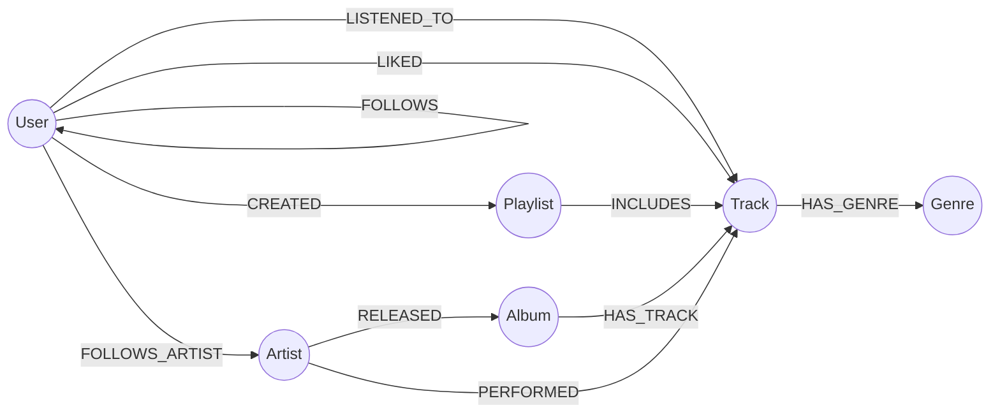

#  Spotify-like Graph — Recomendação musical com Neo4j Aura

Projeto de modelagem em grafos para um serviço de streaming de música (estilo Spotify), construído no **Neo4j Aura** com **Cypher** e carga via **LOAD CSV**.

> Desafio de Projeto — DIO + Neo4j

##  Contexto do problema

Plataformas de streaming precisam responder perguntas como:

- O que este usuário provavelmente vai querer ouvir agora?
- Quais artistas estão crescendo em cada país?
- Quem tem gosto parecido com quem? Quem influencia quem?
- Quais artistas colaboram entre si?

Essas perguntas dependem de **conexões** (usuário → faixa → artista → gênero → outros usuários).

## 🕸️ Por que grafos?

| Pergunta | Em SQL | Em grafo |
|---|---|---|
| "Quem ouviu o que eu ouvi e o que mais ouviu?" | Vários JOINs em tabelas grandes (`listens` × `listens` × `tracks`) | Um único padrão: `(me)-[:LISTENED_TO]->()<-[:LISTENED_TO]-(outro)` |
| Amigos de amigos que seguem um artista | JOINs recursivos / CTEs | `(me)-[:FOLLOWS]->()-[:FOLLOWS_ARTIST]->(a)` |
| Menor caminho entre dois usuários | Muito complexo | `shortestPath(...)` nativo |

O custo de uma travessia em grafo depende só dos nós visitados, não do tamanho total da base, o que favorece recomendação e análise de redes sociais.

##  Modelo do grafo




<!-- Substitua pelo print de CALL db.schema.visualization() ou pelo desenho do arrows.app -->

### Nós e propriedades

| Label | Propriedades |
|---|---|
| `User` | `user_id`, `name`, `country`, `plan`, `birth_year`, `signup_date` |
| `Artist` | `artist_id`, `name`, `country`, `formed_year` |
| `Album` | `album_id`, `title`, `release_year` |
| `Track` | `track_id`, `title`, `duration_sec`, `explicit` |
| `Genre` | `name` |
| `Playlist` | `playlist_id`, `name`, `is_public`, `created_at` |

### Relacionamentos

| Relacionamento | Propriedades | Observação |
|---|---|---|
| `(User)-[:LISTENED_TO]->(Track)` | `listen_id`, `played_at`, `seconds_played`, `device` | Um por execução (evento) |
| `(User)-[:LIKED]->(Track)` | `liked_at` | |
| `(User)-[:FOLLOWS]->(User)` | `since` | |
| `(User)-[:FOLLOWS_ARTIST]->(Artist)` | `since` | |
| `(User)-[:CREATED]->(Playlist)` | | |
| `(Playlist)-[:INCLUDES]->(Track)` | `position`, `added_at` | |
| `(Artist)-[:RELEASED]->(Album)` | | |
| `(Album)-[:HAS_TRACK]->(Track)` | `track_number` | |
| `(Artist)-[:PERFORMED]->(Track)` | `role` (`main` / `featured`) | Permite participações especiais |
| `(Track)-[:HAS_GENRE]->(Genre)` | | Uma faixa pode ter mais de um gênero |

### Decisões de modelagem

- **Gênero como nó** (e não propriedade): permite navegar de gênero para faixas e usuários, e evita erros de digitação.
- **`LISTENED_TO` como relacionamento com propriedades**, em vez de nó `Listen`: o modelo fica mais simples e as consultas mais curtas. Se fosse preciso ligar a execução a outros elementos (ex.: sessão), eu a promoveria a nó.
- **`PERFORMED` com `role`**: modela participações especiais sem duplicar faixas.

##  Estrutura do repositório

```
spotify-neo4j-aura/
├── README.md
├── data/                  # CSVs (dados fictícios)
├── cypher/
│   ├── 01_constraints.cypher
│   ├── 02_load_data.cypher
│   ├── 03_verify.cypher
│   └── 04_queries.cypher
├── scripts/
│   └── generate_data.py   # gera os CSVs (seed fixa → reproduzível)
└── images/                # prints do esquema e das consultas
```

##  Dataset

Todos os dados são **fictícios**, gerados por `scripts/generate_data.py` (`random.seed(42)`), para não haver direitos autorais nem dados pessoais.

| Arquivo | Linhas | | Arquivo | Linhas |
|---|---|---|---|---|
| `users.csv` | 16 | | `listens.csv` | 248 |
| `artists.csv` | 10 | | `follows_users.csv` | 41 |
| `albums.csv` | 12 | | `follows_artists.csv` | 45 |
| `tracks.csv` | 48 | | `playlists.csv` | 8 |
| `genres.csv` | 9 | | `playlist_tracks.csv` | 56 |
| `track_genres.csv` | 55 | | `likes.csv` | 64 |
| `artist_tracks.csv` | 55 | | | |

Resultado esperado após a carga: **103 nós** e **632 relacionamentos**.

##  Como executar

1. **Crie a instância:** em [console.neo4j.io](https://console.neo4j.io), crie uma instância **AuraDB Free**. Baixe e guarde o arquivo de credenciais (a senha só aparece uma vez).
2. **Publique este repositório no GitHub como público** (o Aura precisa baixar os CSVs pela URL *raw*).
3. **Ajuste as URLs:** em `cypher/02_load_data.cypher`, troque `SEU_USUARIO` pelo seu usuário do GitHub.
4. **Abra o Query** (ou Neo4j Browser) na sua instância.
5. **Rode, nesta ordem:** `01_constraints.cypher` → `02_load_data.cypher` → `03_verify.cypher` → `04_queries.cypher` (um comando por vez).
6. Confira os totais com o `03_verify.cypher`.

Para regenerar os dados: `python scripts/generate_data.py` (apenas Python 3, sem dependências).

##  Perguntas de negócio e evidências

| # | Pergunta | Query |
|---|---|---|
| Q1 | Quais as 10 faixas mais ouvidas? | `04_queries.cypher` |
| Q2 | Quais artistas têm mais ouvintes únicos? | |
| Q3 | Top 3 gêneros por país | |
| Q4 | Recomendação de faixas (filtragem colaborativa) | |
| Q5 | Artistas que meus amigos seguem e eu não | |
| Q6 | Rede de colaborações entre artistas | |
| Q7 | Faixas mais presentes em playlists | |
| Q8 | Usuários mais influentes | |
| Q9 | Consumo por plano (Free/Premium/Family) | |
| Q10 | Graus de separação entre dois usuários | |
| Q11 | Usuários com gosto mais parecido (Jaccard) | |
| Q12 | Descoberta nos gêneros favoritos | |

### Evidências visuais

<!-- Adicione seus prints em images/ e referencie aqui. Exemplos: -->


##  Autor

**Rafael Araujo** — [LinkedIn](https://linkedin.com/in/rafael-siqueira-de-araujo-236108407) · [GitHub](https://github.com/Rafael-Araujo22)
